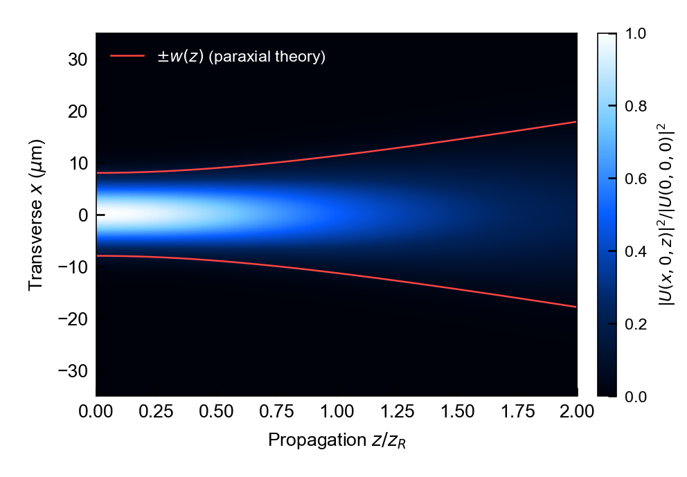
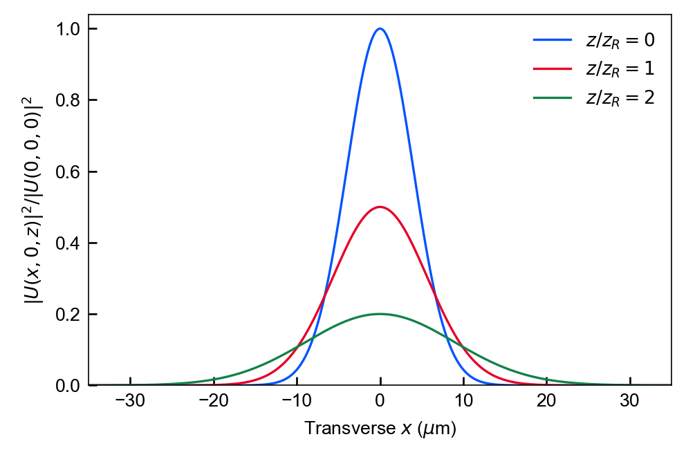
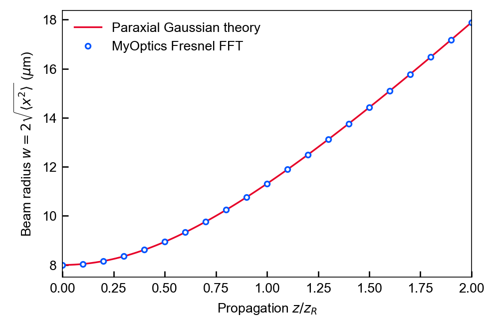

# MyOptics

**基于 GPU 的 Python 傅里叶光学工具：搭建光路、传播复场、检查结果。**

[English](README.md) · [快速上手](docs/quickstart.md) · [API](docs/api/system.md) · [示例索引](examples/README.md) · [图集](docs/showcase/gallery.html)



这是独立生成的通用高斯光束演示。背景为数值强度，红线为近轴理论的光束半径。[生成源码](examples/public_gaussian.py)和[参数、检查结果、环境记录](docs/showcase/manifest.json)随图提供。

## 已有功能

| 模块 | 已实现内容 |
| --- | --- |
| 标量光学 | 带缓存的角谱传播，Fresnel 与 Rigorous 模式；透镜、光阑、光栅、实空间与动量空间滤波器 |
| 矢量光学 | 三分量场、谱域横场投影、Jones 元件与 Richards–Wolf 聚焦 |
| 多层膜 | 传输矩阵计算及嵌入传播流程的多层膜传递函数 |
| 工作流 | Field 容器、参数扫描、相干／非相干宽谱合成 |
| 结果检查 | 横截面、纵截面、强度和相位图，以及物理回归测试 |

本项目适合使用明确近似条件的傅里叶光学模型。标量 `Rigorous` 模式采用均匀介质的精确角谱色散关系；该名称不表示任意几何的全矢量 Maxwell 求解器。各模型的适用条件见[物理说明](docs/physics/angular-spectrum.md)及对应源码。

## 安装与运行

GPU 传播需要 **Python 3.10+**、支持 CUDA 12 的 NVIDIA 驱动，以及项目声明的 CuPy 依赖。

```bash
python -m venv .venv
# Windows:
.venv\Scripts\activate
# Linux/macOS: source .venv/bin/activate
python -m pip install -r requirements.txt
python -m pip install -e .
python examples/public_gaussian.py
```

最后一条命令在 `docs/showcase/` 生成三张 PNG/SVG 图及 JSON manifest，无需下载光束、材料或实验数据。Windows 下应先导入 `optical_system`，让仓库的 CUDA DLL 路径发现代码先运行。安装命令供新环境使用，本次图稿直接使用已有环境生成。

最小传播示例：

```python
import numpy as np
from optical_system.system import OpticalSystem
import cupy as cp
from propagation.propagator import AngularSpectrumPropagator

x = cp.linspace(-64, 64, 512, endpoint=False)  # 单位：微米
X, Y = cp.meshgrid(x, x)
u0 = cp.exp(-(X**2 + Y**2) / 8.0**2)
propagator = AngularSpectrumPropagator(x, x, wavelength=0.532, mode="Fresnel")
u1 = propagator.propagate(u0, z=np.pi * 8.0**2 / 0.532)
intensity = cp.asnumpy(cp.abs(u1)**2)
```

所有长度必须使用同一单位。`OpticalSystem` 会把初场归一化为单位离散平方范数；上面的底层传播器示例保留输入幅度。


## 如何读示例

| 参数 | 数值 |
| --- | --- |
| 波长／初始振幅腰斑半径 | 0.532 µm／8 µm |
| 网格／采样间距 | 512 × 512／0.25 µm |
| FFT 周期窗口 | 两轴均为 [−64, 64) µm |
| 传播区间 | Fresnel，101 个平面，0 ≤ z ≤ 2zᵣ；zᵣ = πw₀²/λ ≈ 377.94 µm |
| 强度归一化 | 所有平面共用“输入轴上峰值 = 1” |
| 半径定义 | w = 2√⟨x²⟩，以完整二维强度加权 |

<table>
<tr><td></td><td></td></tr>
<tr><td>相同输入归一化下的展宽与峰值下降。</td><td>Fresnel FFT 半径与解析近轴半径比较。</td></tr>
</table>

本例为均匀介质、标量、单色、近轴传播，满足 w₀ ≫ λ。FFT 假设周期窗口，光束应始终远离窗口边界；改变参数后应细化采样、扩大窗口。本例比较的是特定离散化与对应近轴模型，不是相对于一般 Maxwell 解的误差。

记录环境：Python 3.11.9、MyOptics 0.5.1、NumPy 2.1.2、Matplotlib 3.9.2、CuPy 13.3.0、NVIDIA RTX 4060。本次半径最大相对误差为 1.17 × 10⁻¹²，离散总功率漂移为 4.44 × 10⁻¹⁶。[完整 manifest](docs/showcase/manifest.json)包含参数、环境及资产哈希。

## 进一步使用

- [示例索引](examples/README.md)：矢量聚焦、q-plate、多层膜及宽谱工作流。
- [快速上手](docs/quickstart.md)、[文档首页](docs/index.md)、[基准记录](docs/benchmark.md)、[变更记录](CHANGELOG.md)。
- `examples/legacy/` 为未按当前 API 持续验证的历史脚本。

```bash
python -m pytest tests/
```

GPU 测试带有标记，无 CUDA 时会跳过；通过测试只覆盖其中具体模型及参数。

## 许可

包元数据目前声明为 **Proprietary**，仓库没有提供开源许可授权。源码公开可见不代表授予通用再分发或复用权利。
